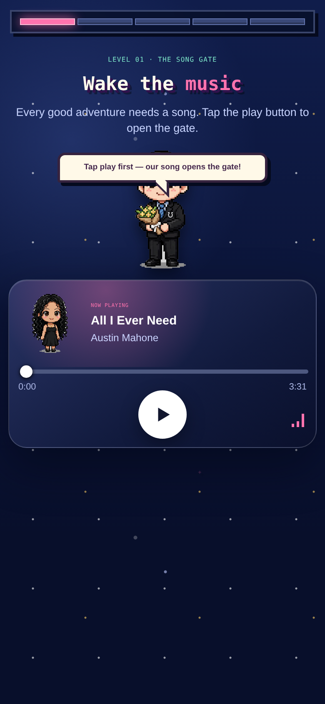
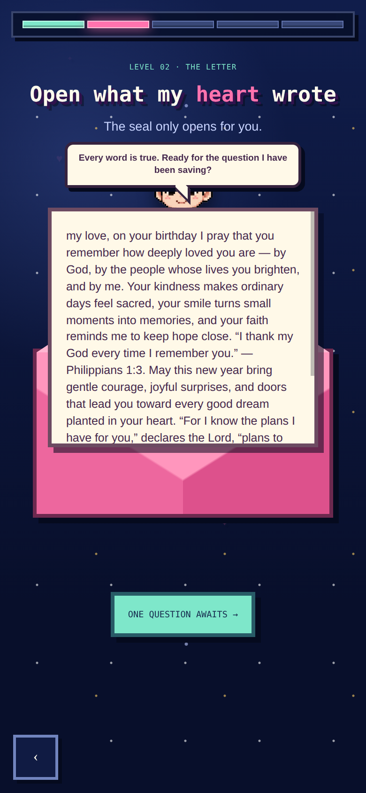
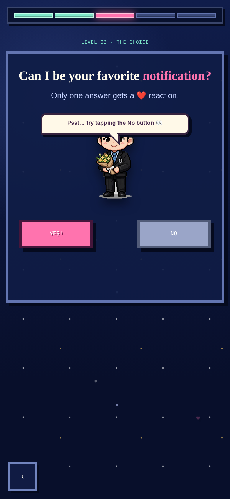
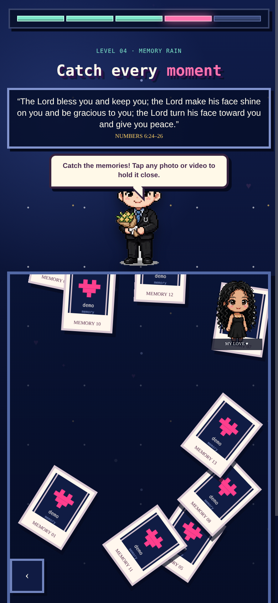
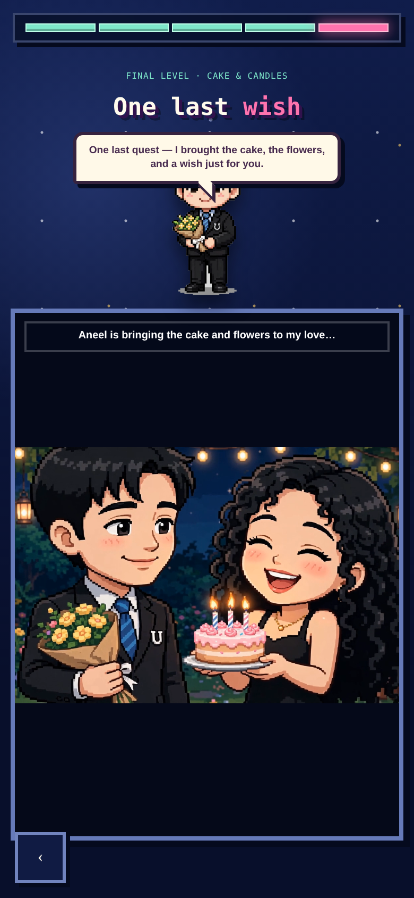

# Birthday Surprise 💜

**A Birthday Quest** — a pixel-art birthday surprise web experience. A five-level night adventure built as a single static site (HTML + CSS + JS, no backend, no build step).

## Screenshots

| Level 01 · Song Gate | Level 02 · Letter |
|---|---|
|  |  |

| Level 03 · Choice | Level 04 · Memory Rain |
|---|---|
|  |  |

| Final Level · Cake & Candles |
|---|
|  |

## The Quest

1. 🎵 **The Song Gate** — an iPhone-style inline music player. Tap play to open the gate.
2. 💌 **The Letter** — tap the seal to open a typewritten birthday letter with Bible verses (Jeremiah 29:11, Philippians 1:3).
3. 💘 **The Choice** — a playful Yes/No question. The No button dodges on desktop, and on mobile it jumps, shrinks, and finally surrenders after 5 taps.
4. 🌧️ **Memory Rain** — catch 14 falling photo & video memories (Numbers 6:24–26).
5. 🎂 **Cake & Candles** — a pixel-art finale: he brings cake and flowers, she blows out the candles (Psalm 20:4), fireworks included.

Extras: a pixel-art guide avatar with cheeky speech bubbles on every level, confetti & heart effects, full mobile-portrait layout, reduced-motion support, and a Play Again button that resets the whole experience.

## Run it

### Option 1 — Just open it

Open `index.html` in any modern browser. That's it.

### Option 2 — Serve locally

```bash
# with node
npx serve .

# or with python
python3 -m http.server 8000
```

Then visit http://localhost:8000 (or the port shown).

### Option 3 — Deploy it

It's a static site — deploy the folder anywhere:

```bash
# Vercel
npx vercel --prod

# Netlify
npx netlify-cli deploy --prod --dir=.
```

Or drag the folder into Netlify Drop / connect the repo on Vercel for automatic deploys.

## Project structure

```
birthday-surprise/
├── index.html            # markup for all 5 levels
├── css/
│   └── style.css         # pixel-art night theme, mobile-first
├── js/
│   └── app.js            # quest flow, letter typewriter, memory rain, finale
├── assets/
│   ├── img/              # pixel avatars, demo memory cards, finale poster
│   ├── audio/            # the song (MP3)
│   └── video/            # finale animation (MP4)
└── screenshots/          # preview images used above
```

## Demo version

This public repo is a **demo/template**:

- The Memory Rain level uses placeholder demo cards instead of real photos and videos.
- Names are generic ("my love") — search the project for `my love` and make it yours.

## Make it yours

1. Replace the `data-src` / `data-poster` attributes on the `.memory-drop` buttons in `index.html` with your own photos and videos (drop files into `assets/` and reference them).
2. Edit the letter text, the finale lines, and the verses in `index.html` / `js/app.js`.
3. Swap `assets/audio/song.mp3` and the avatars in `assets/img/` for your own.
4. Deploy the folder — done.

## Tech

- Plain HTML, CSS, JavaScript — no frameworks, no build, no dependencies.
- Pixel-art UI rendered with CSS (`image-rendering: pixelated`) and canvas confetti.
- Media plays inline via `<audio>` / `<video>` — no embeds.

Made with 💜 as a birthday surprise.
